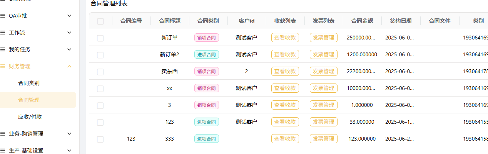
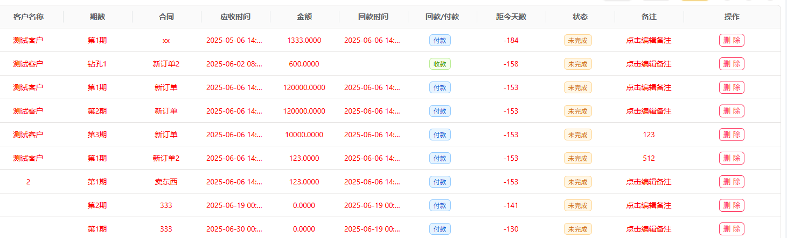
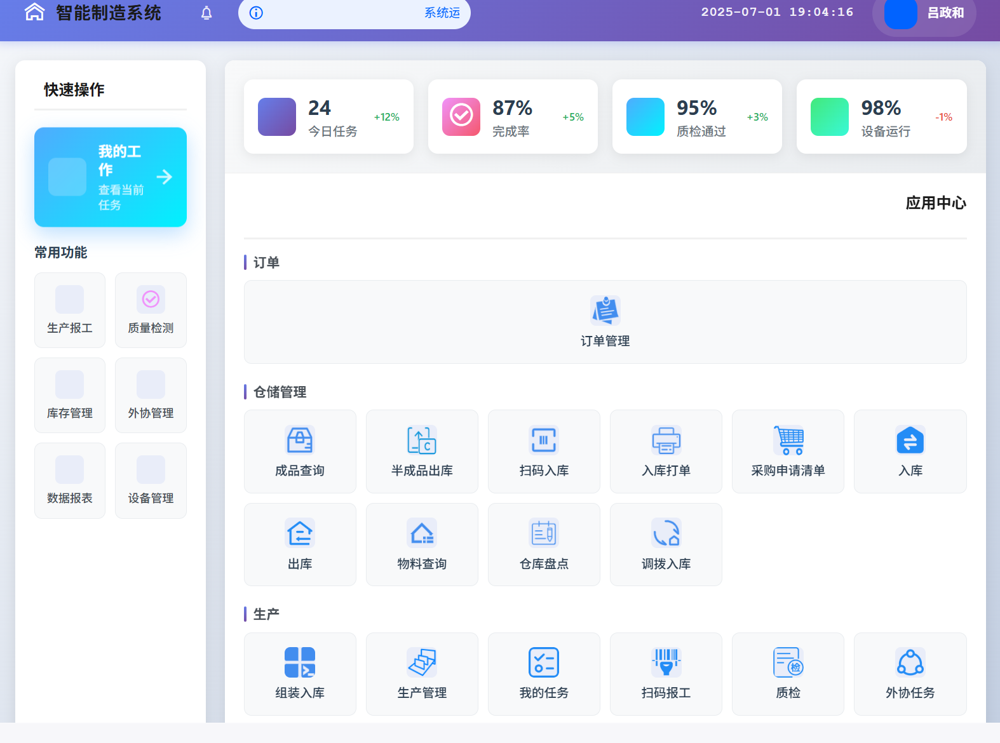
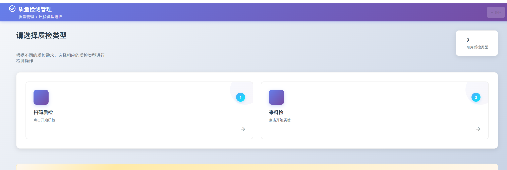
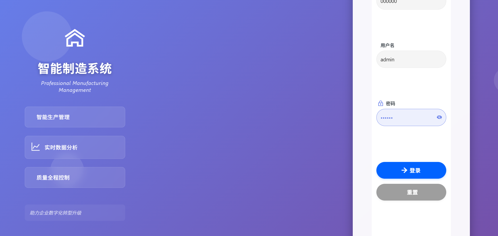
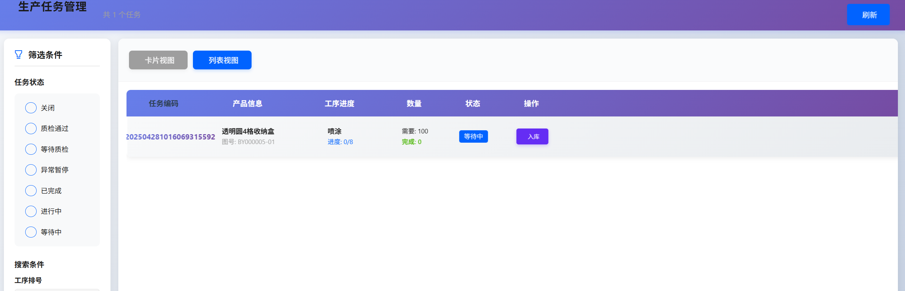

## 导航页

## 订单下达

.gif)

## MRP计算

## 排程计划

## 班次管理

## 手机端报工

## 体验体制：
## > >官方前端项目地址: [Liaoyun](http://mes.llcoms.com) 

## > 企业编码303036，账号ceshi01密码123456

> 成员前端项目地址: 基于vben5 [ruoyi-plus-vben5](https://gitee.com/dapppp/ruoyi-plus-vben5)
>了云制造，开源版本，包含功能模块：
合同管理：合同类别、发票管理、应收/应付款
>购销管理：客户供应商管理、销售订单、MRP计算

>基础设置：班组管理、计量单位、品类管理、BOM管理、车间管理、
> 设备类别、质检管理、外协管理、工艺管理。班组/部门管理、移动套餐、移动端权限、移动端目录

> 排产任务：生产单元、组装排程、工序排程、生产任务、任务流转

> 库存管理：库存分类、库存流水、仓库信息、入库【采购入库、委外入库、其他入库】、出库【销售出库、委外出库、其他出库】、App入库审核、
> App出库审核、App采购审核、库位盘点、库位调拨、出入库记录、采购成本波动

> 设备与工具：夹具仓库、磨具仓库、刀具仓库、设备点检

> 审核与报表：异常报工审核、磨具使用记录、组装流转、物流信息
> 、入库记录、刀具审批、夹具审批、打单列表、质检列表、刀具使用统计、夹具使用统计、
> 外协统计记录、来料检记录、设备点检记录、已工作记录

## 系统框架
> 采用ruoyi-plus-vue/多租户模式，可用于分厂。前端有两套一套为ele、一款为antd。
> 
## 其他说明
>>本系统出入库采取FIFO策略，如果出库选择库位就进行库位出库。
>  不选择库位，就执行FIFO先入先出。
>  BOM支持组件模式添加，举例：A、B产品都包含固定的c1组件+颜色（可变）。可以先编辑C1组件。A、B产品填写BOM拖拽进去就行
>  工序与产品都可以拖住批量添加、拖入工序自动计算全部工序所需时间和工费。
>  MRP计算中，支持订单全部委外。
>  简单的oa审批

## 软件架构图

## 演示图例
 
 
 
 
     
  

---------------------
 ## **商业版新增PAD 中控段** 

- - -
## 平台简介
#  源码开源有80%以上。若依框架AI很好补。数据库和代码文档一直有人问。数据库直接去下载狮子大佬的ruoyi-vue-plus，里面的基础数据再加上本项目的mes开头的数据，操作和启动文档，都参考ruoyi-vue-plus。加QQ备注清。
QQ：2498828866