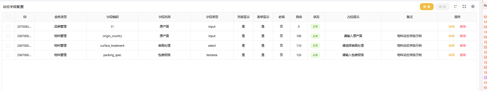
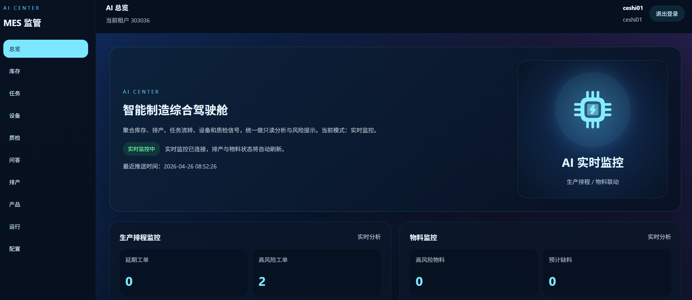
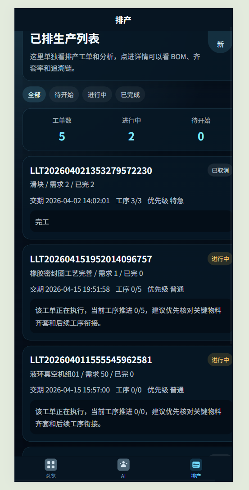
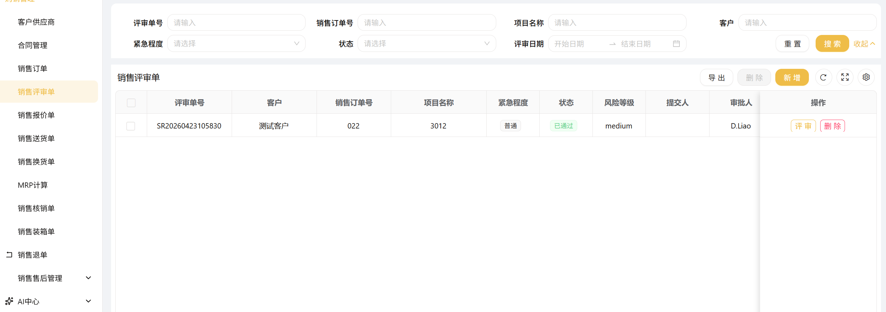
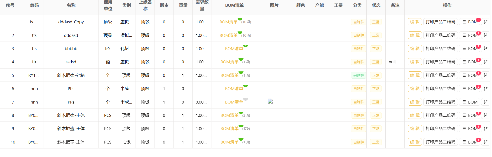
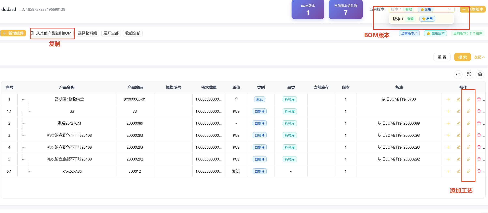

# Liao-MES 二次开发:离散制造 MES 六大模块 + EAP 集成

基于开源 [Liao-MES](https://gitee.com/foloch/Liao-mes)(RuoYi-Vue-Plus 5.3 多租户架构,MIT)的二次开发项目,
面向 MES 开发/制造业数字化 Java 岗位。二开代码集中在 `com.liaoyun.mes` 包下
`eap / mrp / fifo / trace / dispatch` 五个子包与 5 张新表,全部模块带端到端验收脚本,实测数字可复现。

设备侧采集网关(EAP Gateway,Modbus/SECS-GEM/MQTT 多协议接入)为独立项目,
仓库:[pengbo-web/eap-gateway-demo](https://github.com/pengbo-web/eap-gateway-demo),两仓库通过 RabbitMQ 事件总线与 HTTP 双通道集成。

## 一、二次开发模块与实测指标

| # | 模块 | 入口 | 实测 |
| --- | --- | --- | --- |
| 1 | EAP 设备事件集成:自动报工、工单工序推进、报警转待审核异常单(不自动停线) | `com.liaoyun.mes.eap` `POST /mes/eap/event`(密钥通道) | 多设备并发活链,报工/异常单/任务推进全断言 |
| 2 | MES 侧 RabbitMQ 消费接入:手动 ack+死信、消费侧 SETNX 幂等(与网关构成三跳防重)、业务性跳过防空转刷死信、报警备注溢出修复 | `EapMqConsumer`(队列 `mes.integration`) | 自动报工/mid 幂等/报警单/脏报文入死信 全过 |
| 3 | MRP 递归 N 层展开 + 净需求计算:循环引用保护、BigDecimal 4 位精度、深度可配 | `com.liaoyun.mes.mrp` | 4 层 BOM 夹具,毛需求 20→40→80→160 逐层断言 |
| 4 | 批次级 FIFO 出库分配器:替换库位级存储过程 sp_inout,分配明细落表、扣减行回填来源批次 | `com.liaoyun.mes.fifo` | 出库 40=旧批 30+新批 10,批次回填率 100% |
| 5 | OEE 三率引擎 + 设备状态看板:状态流水区间积分、离线截断、跨天清零;ECharts 大屏免登录直开 | `com.liaoyun.mes.eap.MesOeeService` `/mes/eap/dashboard-ui` | 8 项指标与独立手算一致(误差≤0.1) |
| 6 | SN 双向追溯:正向件级树(SN→任务→工序链,含设备与工艺参数快照)、反向批次级召回 | `com.liaoyun.mes.trace` `/mes/trace/*` | 正向万级工序节点/快照命中,反向命中受影响工单群 |
| 7 | 工序自动派工规则引擎:能力匹配+未暂停+负载得分选站、完工自动流转下工序、报警联动暂停与改派 | `com.liaoyun.mes.dispatch` `/mes/dispatch/*` | 低负载中选/流转/改派三段断言,`eap.dispatch.enabled` 可回退 |

新增 5 张表:`mes_eap_device`、`mes_eap_device_state_log`、`mes_eap_device_spec`、`mes_workplace_suspend`、`mes_fifo_alloc`;
存量表加列:`mes_work_rec.device_code/params`(追溯快照)、`mes_task.workplace_dispatch`(派工方式)。

## 二、快速启动

### 1. 环境要求

- JDK 17、Maven 3.8+
- MySQL 8.x、Redis 6+
- RabbitMQ 3.x(仅 EAP MQ 消费通道需要;缺失时应用可启动,消费容器自动重试)
- Node 18+ 与 pnpm(前端)

### 2. 数据库初始化(推荐路径)

```sql
CREATE DATABASE liaoyun DEFAULT CHARACTER SET utf8mb4 COLLATE utf8mb4_general_ci;
```

依次导入(本仓库 `script/sql/secondary-dev/`):

1. `01_schema_full.sql` —— 全量表结构(已含二开新表与加列)
2. `02_base_data.sql` —— 系统基础数据(用户/租户/菜单/字典/客户端,登录账号 admin)

> 从上游原版基线升级的存量环境:改用 `03_secondary_upgrade.sql`(5 张新表 + 3 条 ALTER;
> ALTER 重复执行报 Duplicate column 可忽略)。

### 3. 后端

```bash
# 按本机环境修改 liaoyun-admin/src/main/resources/application-dev.yml 的 MySQL/Redis 连接;
# RabbitMQ 连接在 application.yml 的 spring.rabbitmq(默认 localhost:5672 root/123456)
mvn clean package -DskipTests
java -jar liaoyun-admin/target/liaoyun-admin.jar
# 内存受压机器建议: java -Xms256m -Xmx1024m -jar liaoyun-admin.jar
```

后端端口 **8188**(application.yml `server.port`)。

### 4. 前端

```bash
cd plus-ui-ts
pnpm install
pnpm dev
```

开发端口见 `.env.development` 的 `VITE_APP_PORT`(本仓库为 81),`/dev-api` 已代理至 `localhost:8188`。
浏览器打开 `http://localhost:81`,登录 **admin / admin123**,租户 **000000**。

> 注:作者提供的 dist 构建产物(nginx 部署)存在缺陷,推荐使用 dev 模式;登录页表单列宽塌缩问题已修复(见提交记录)。

### 5. EAP 设备集成(可选)

- **MQ 通道**:启动 [EAP 采集网关](https://github.com/pengbo-web/eap-gateway-demo)后,网关向交换机 `eap.events` 发布统一事件,
  本系统消费队列 `mes.integration`(routing key `eap.#`),自动完成报工与报警联动;
- **HTTP 通道**:`POST /mes/eap/event`,请求头 `X-EAP-Key: eap-demo-key`(演示密钥,生产应改配置),
  与 MQ 通道互为备份;
- 设备编码→流转批次(mes_task.sn)映射在网关侧配置,事件到达后按 SN 匹配进行中任务。

## 三、验收与回归

本项目(MES 侧)验收脚本与数据夹具位于本仓库 `eap-gateway/` 目录(`verify_mrp/fifo/oee/trace/dispatch/t6` 与
`fixtures/*.sql`);网关侧验收(t1~t5b)、设备模拟器与覆盖两项目的一键回归 `verify_e2e.py` 位于
[eap-gateway-demo](https://github.com/pengbo-web/eap-gateway-demo) 仓库。脚本以 admin 身份走真实接口断言数据库落库结果。

## 四、二开相关文件导览

```
liaoyun-modules/liaoyun-mes/src/main/java/com/liaoyun/mes/
├── eap/         EAP 集成(HTTP 接口、MQ 消费、自动报工/报警、OEE 引擎、看板)
├── mrp/         MRP 递归展开与净需求
├── fifo/        批次级 FIFO 分配器
├── trace/       SN 双向追溯
├── dispatch/    派工规则引擎与工作站暂停
script/sql/secondary-dev/   全量 schema / 基础数据 / 增量升级脚本
docs/技术方案-项目二六模块.md  设计与验收文档
```

多租户注意点:机器通道(EAP)无登录态,服务层以 `TenantHelper.dynamic` 显式切换租户 +
`DataPermissionHelper.ignore` 绕过数据权限;实体加列需同步 Bo(MapStruct unmappedTargetPolicy=ERROR);
`BaseEntity.params` 与业务字段冲突时以 `@TableField("params")` 映射别名(见 `MesWorkRec.eapParams`)。

---

## 上游项目原始说明(Liao-MES,作者 D.Liao)

> 以下为上游仓库原 README 内容,版权归作者所有;本 fork 仅包含上述二次开发部分,其余 CRUD 与前端为作者代码。

##新增动态字段。支持所有表的字段自定义与搜索

## 导航页


## 增加ai智能体分析APS策略


## ai手机端


## MOM订单管理


## BOM版本管理




## 订单下达

.gif)

## MRP计算


## 排程计划


## 班次管理


## 手机端报工

## 体验体制:
## > >官方前端项目地址: [Liaoyun](http://mes.llcoms.com)<br>

## > 企业编码303036,账号ceshi01密码123456


> 成员前端项目地址: 基于vben5 [ruoyi-plus-vben5](https://gitee.com/dapppp/ruoyi-plus-vben5)
>了云制造,开源版本,包含功能模块:
合同管理:合同类别、发票管理、应收/应付款
>购销管理:客户供应商管理、销售订单、MRP计算

>基础设置:班组管理、计量单位、品类管理、BOM管理、车间管理、
> 设备类别、质检管理、外协管理、工艺管理。班组/部门管理、移动套餐、移动端权限、移动端目录

> 排产任务:生产单元、组装排程、工序排程、生产任务、任务流转

> 库存管理:库存分类、库存流水、仓库信息、入库【采购入库、委外入库、其他入库】、出库【销售出库、委外出库、其他出库】、App入库审核、
> App出库审核、App采购审核、库位盘点、库位调拨、出入库记录、采购成本波动

> 设备与工具:夹具仓库、磨具仓库、刀具仓库、设备点检

> 审核与报表:异常报工审核、磨具使用记录、组装流转、物流信息
> 、入库记录、刀具审批、夹具审批、打单列表、质检列表、刀具使用统计、夹具使用统计、
> 外协统计记录、来料检记录、设备点检记录、已工作记录

## 系统框架
> 采用ruoyi-plus-vue/多租户模式,可用于分厂。前端有两套一套为ele、一款为antd。
> 
## 其他说明
>>本系统出入库采取FIFO策略,如果出库选择库位就进行库位出库。
> <br>不选择库位,就执行FIFO先入先出。
> <br>BOM支持组件模式添加,举例:A、B产品都包含固定的c1组件+颜色(可变)。可以先编辑C1组件。A、B产品填写BOM拖拽进去就行
> <br>工序与产品都可以拖住批量添加、拖入工序自动计算全部工序所需时间和工费。
> <br>MRP计算中,支持订单全部委外。
> <br>简单的oa审批

## 软件架构图


## 演示图例
 
 
 
 
     
  

---------------------
 ## **商业版新增PAD 中控段** 


- - -
## 平台简介
#  源码开源有80%以上。若依框架AI很好补。数据库和代码文档一直有人问。数据库直接去下载狮子大佬的ruoyi-vue-plus,里面的基础数据再加上本项目的mes开头的数据,操作和启动文档,都参考ruoyi-vue-plus。加QQ备注清。
QQ:2498828866
